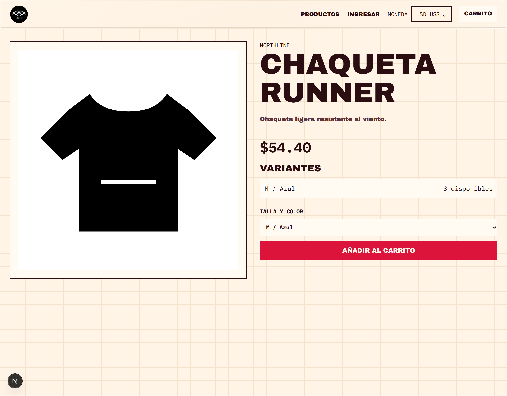
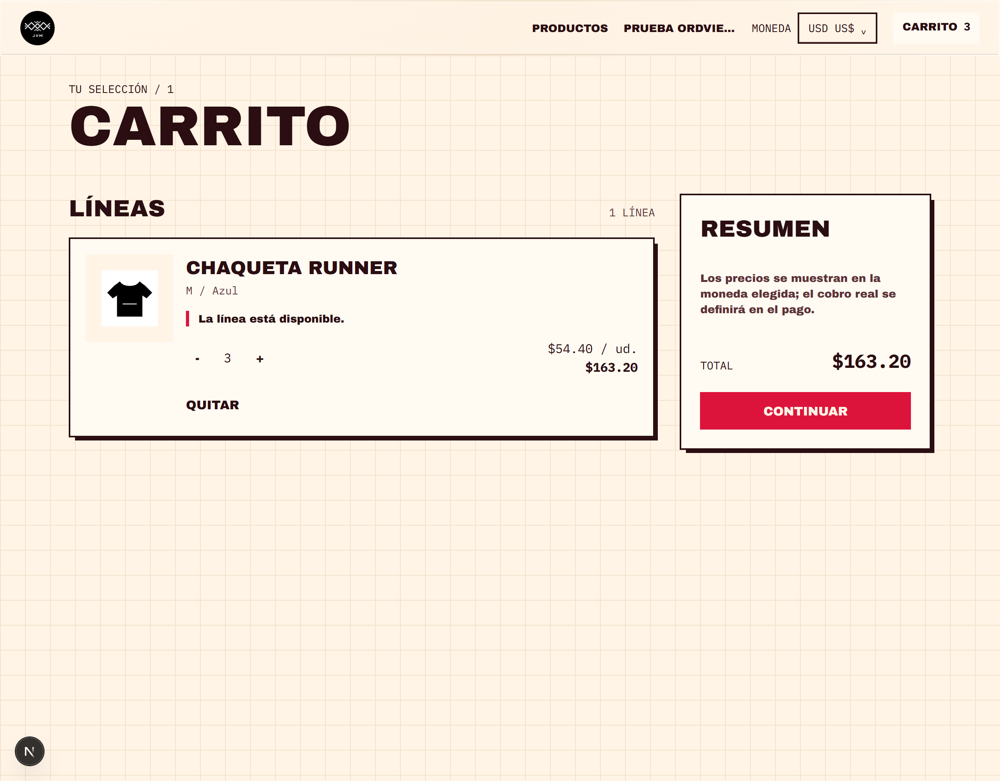
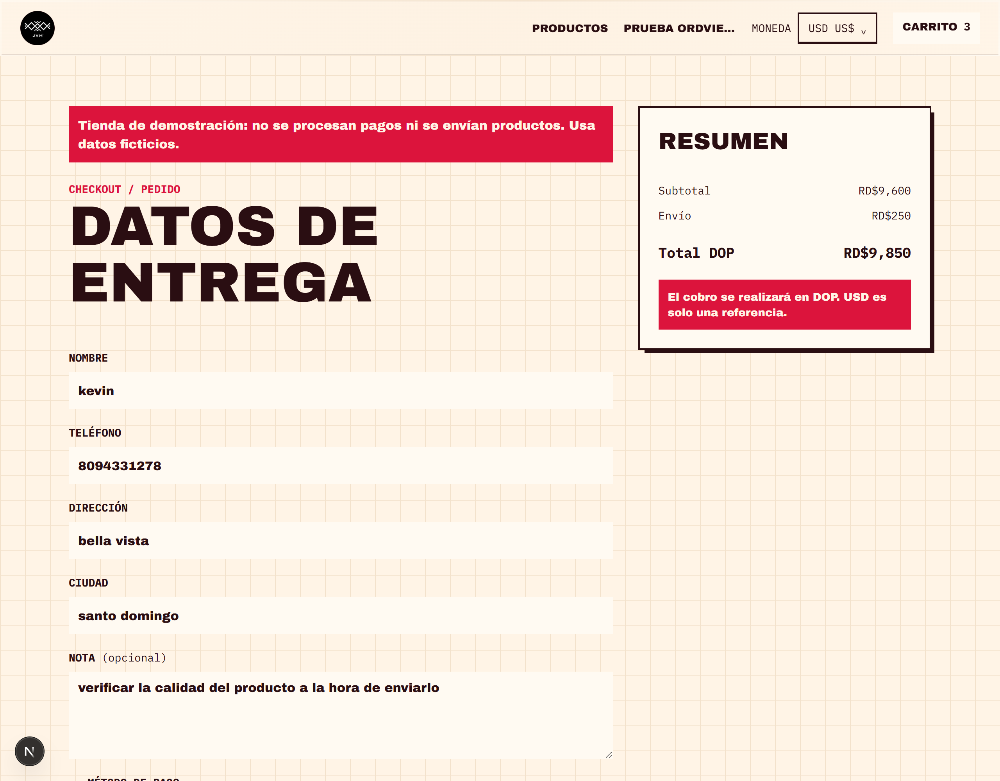
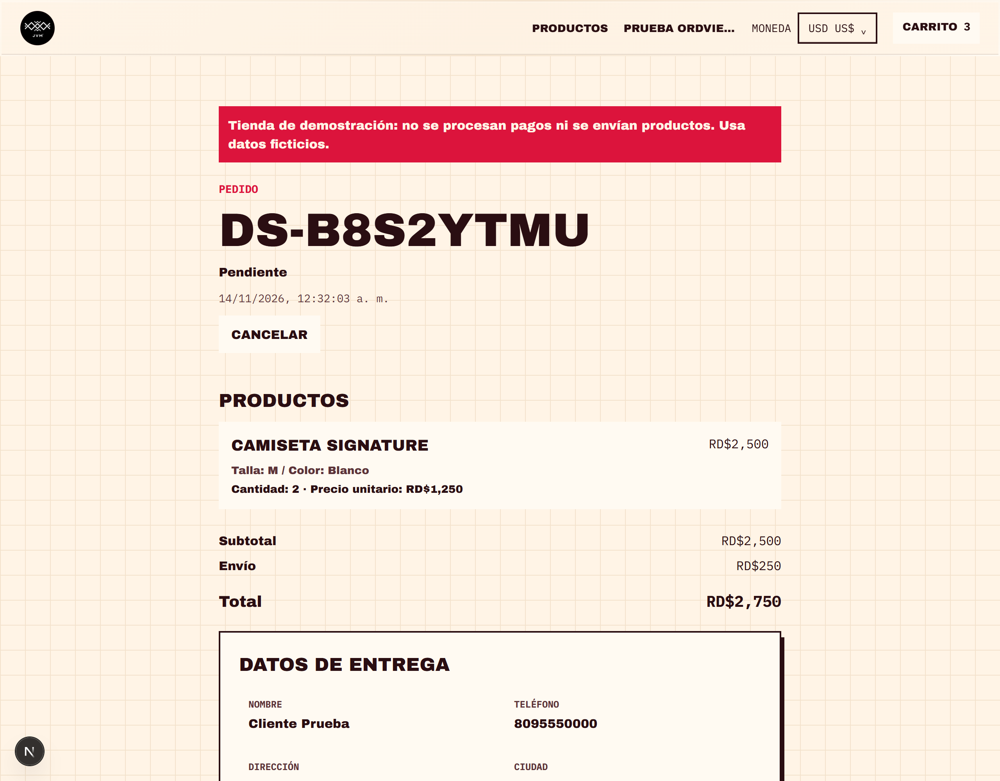
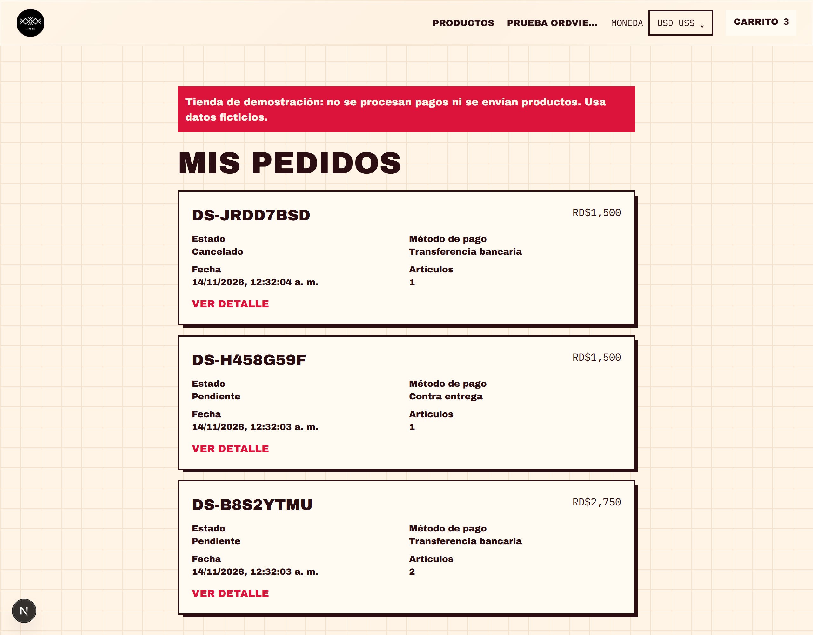
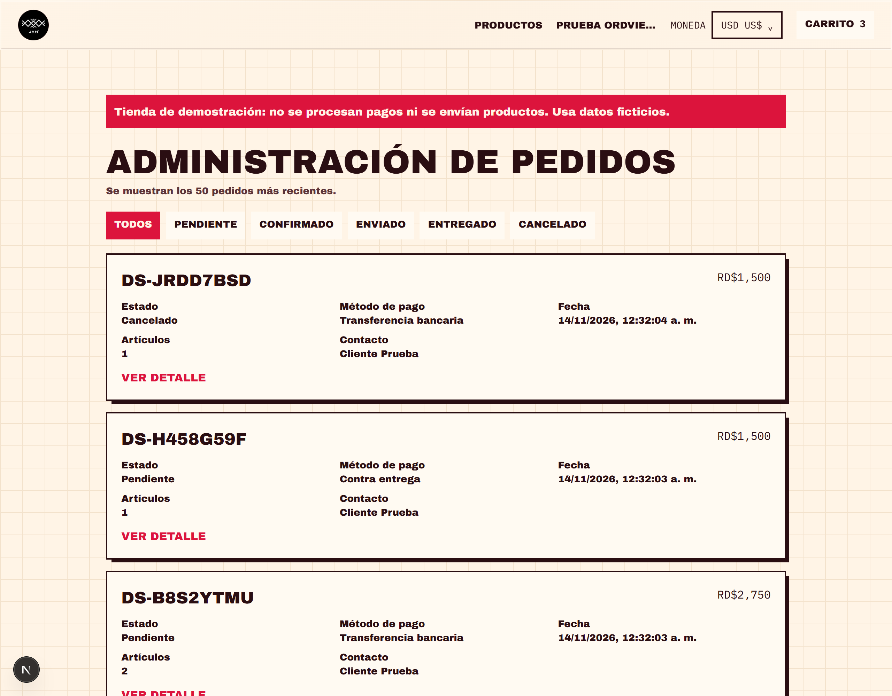
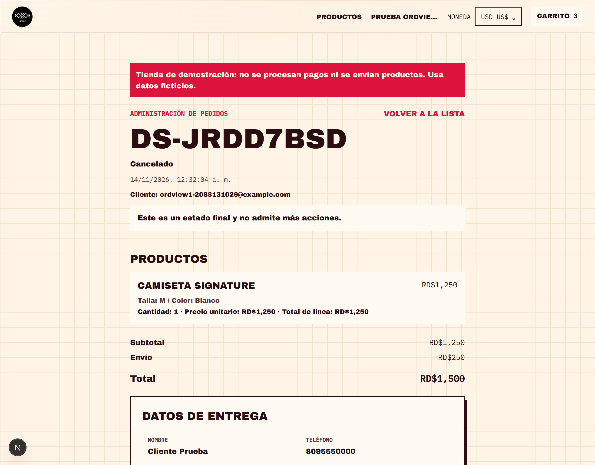
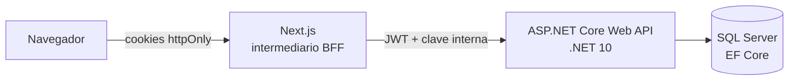

# DigiStyles

Tienda web de ropa, tenis y accesorios, construida como proyecto de portafolio con enfoque **Full Stack .NET**. Cubre el recorrido completo de una compra (catálogo, carrito, cuenta, checkout, seguimiento de pedidos) y un panel de administración, con atención especial a la **consistencia del stock y la seguridad de las sesiones**.

> **Esto es una demostración.** No se procesan pagos reales ni se envían productos. Usa siempre datos ficticios.

**Demo en línea:** [pendiente: enlace cuando esté desplegada]

## Capturas

| Catálogo | Detalle del producto |
|---|---|
|  |  |

| Carrito | Checkout |
|---|---|
|  |  |

| Detalle de un pedido | Mis pedidos |
|---|---|
|  |  |

| Panel de administración | Detalle en administración |
|---|---|
|  |  |

## Qué demuestra este proyecto

- **Stock correcto bajo concurrencia.** El stock se descuenta al crear el pedido, dentro de una transacción, con un `UPDATE` condicional ordenado por variante. Si dos personas compran el último artículo a la vez, solo una lo consigue y el stock nunca queda negativo.
- **Pedidos idempotentes.** Cada pedido lleva una clave de idempotencia comparada con un hash SHA-256 del contenido normalizado: repetir el mismo envío (doble clic, reintento tras un corte) devuelve el mismo pedido sin duplicarlo ni descontar el stock dos veces.
- **El servidor manda.** El cliente solo envía líneas, método de pago, datos de contacto y el total que cree ver. El servidor recalcula precios, envío y total, y avisa si el precio cambió.
- **Cancelaciones seguras.** Cancelar devuelve el stock una sola vez, incluso con varias peticiones simultáneas (por ejemplo, el cliente y un administrador a la vez).
- **Sesiones endurecidas.** JWT de 15 minutos más refresh token de 14 días que rota en cada uso (solo se guarda su hash); reutilizar uno ya revocado cierra todas las sesiones del usuario. El navegador solo ve cookies `httpOnly`: Next.js actúa como intermediario (BFF) y el token nunca llega al JavaScript.
- **Control de acceso por rol.** El panel de administración se protege en la API (401 sin sesión, 403 sin rol) y no solo en la pantalla.
- **Límites de peticiones** por usuario y por IP en autenticación, lectura y escritura.

## Arquitectura



- **Frontend:** Next.js 16 (Turbopack), React, TypeScript y Tailwind. Animación solo con CSS.
- **Backend:** ASP.NET Core Web API (.NET 10), Entity Framework Core, ASP.NET Identity.
- **Base de datos:** SQL Server. Precios en DOP; USD y EUR son solo referencia en pantalla.
- **Pagos:** transferencia bancaria o contra entrega, sin pasarela.

## API

| Área | Endpoints |
|---|---|
| Catálogo | `GET /api/categories`, `GET /api/products`, `GET /api/products/{slug}` |
| Carrito | `POST /api/cart/validate` |
| Cuenta | `/api/auth/*` (registro, inicio de sesión, renovación, cierre de sesión y `me`) |
| Checkout | `GET /api/checkout/info` |
| Pedidos | `POST /api/orders`, `GET /api/orders`, `GET /api/orders/{id}`, `POST /api/orders/{id}/cancel` |
| Administración (rol `admin`) | `GET /api/admin/orders`, `GET /api/admin/orders/{id}`, `POST /api/admin/orders/{id}/status` |

Los errores tienen siempre la forma `{ code, message }`. Los precios se almacenan en DOP; las tasas de USD y EUR están en `web/src/config/brand.config.ts` y se actualizan a mano.

## Decisiones técnicas

| Decisión | Motivo |
|---|---|
| Next.js como intermediario con cookies `httpOnly` | El access token y el refresh token no son accesibles desde JavaScript |
| `sp_getapplock` por usuario al crear pedidos | Serializa la creación y hace fiable el tope de 3 pedidos pendientes |
| `UPDATE` condicional en lugar de bloqueos largos | El stock no puede quedar negativo y la transacción es corta |
| El carrito guarda solo `variantId` y `quantity` | Los precios y el stock siempre se revalidan en el servidor |
| Sin `EnableRetryOnFailure` | Evita repetir operaciones con efectos sobre el stock |
| Transiciones de estado explícitas | Pendiente → Confirmado → Enviado → Entregado; cancelar solo desde Pendiente o Confirmado |

## Pruebas

Las garantías críticas se comprueban con scripts de PowerShell contra la API y la base de datos real, y cada uno restaura el stock al terminar:

| Script | Qué cubre | Pruebas |
|---|---|---|
| `probar-pedidos.ps1` | Creación, idempotencia, doble clic, tope de pendientes, último artículo | 32 |
| `probar-lectura.ps1` | Lectura, cancelación, cancelación simultánea | 20 |
| `probar-bff.ps1` | Intermediarios de pedidos en Next.js | 28 |
| `probar-admin.ps1` | API de administración, transiciones, stock, límites | 52 |
| `probar-bff-admin.ps1` | Intermediarios de administración | 29 |

Están en [`docs/pruebas-manuales`](docs/pruebas-manuales). Próximo paso: pasarlas a pruebas automáticas con xUnit y una acción de GitHub.

Comprobaciones de calidad:

```powershell
dotnet build api/DigiStyles.Api.csproj
npm run lint --prefix web
npm run build --prefix web
```

## Cómo ejecutarlo

Requisitos: .NET 10 SDK, Node.js, SQL Server (Developer o Express), `sqlcmd` y `curl`.

1. **Base de datos.** Ajusta `ConnectionStrings:DefaultConnection` en `api/appsettings.Development.json` a tu servidor (la base se llama `DigiStylesDev`). Las migraciones y los 12 productos de ejemplo se aplican al arrancar la API en `Development`.
2. **Secretos de la API** (nunca van al repositorio): `Jwt:Key`, `InternalApi:Key`, `Shipping:FixedCost`, `BankTransfer:BankName`, `BankTransfer:AccountHolder`, `BankTransfer:AccountNumber` y `BankTransfer:AccountType` (datos ficticios en desarrollo). Se guardan con `dotnet user-secrets set "Nombre" "valor" --project api/DigiStyles.Api.csproj`. `Jwt:Key` e `InternalApi:Key` deben tener al menos 32 bytes: se pueden generar con `$b = New-Object byte[] 48; [Security.Cryptography.RandomNumberGenerator]::Create().GetBytes($b); [Convert]::ToBase64String($b)`. La API no arranca si faltan o no son válidos.
3. **Variables de la web.** Copia `web/.env.local.example` a `web/.env.local` y rellena `NEXT_PUBLIC_API_URL`, `INTERNAL_API_KEY` (el mismo valor que `InternalApi:Key`), `WEB_ORIGIN` y `TRUST_PROXY_HEADERS`.
4. **Arranque:**

```powershell
dotnet run --project api/DigiStyles.Api.csproj --launch-profile http
npm run dev --prefix web
```

API en `http://localhost:5008` y web en `http://localhost:3000`.

**Usuario de prueba:** [pendiente: crea una cuenta ficticia y anótala aquí]

## Estado y alcance

Hecho: catálogo, carrito, cuentas, checkout, pedidos, cancelación y panel de administración básico.
Fuera de esta versión: favoritos, pasarela de pago real y visor 3D.

---

Proyecto de portafolio de **[tu nombre]**, estudiante de desarrollo de software en ITLA (República Dominicana).